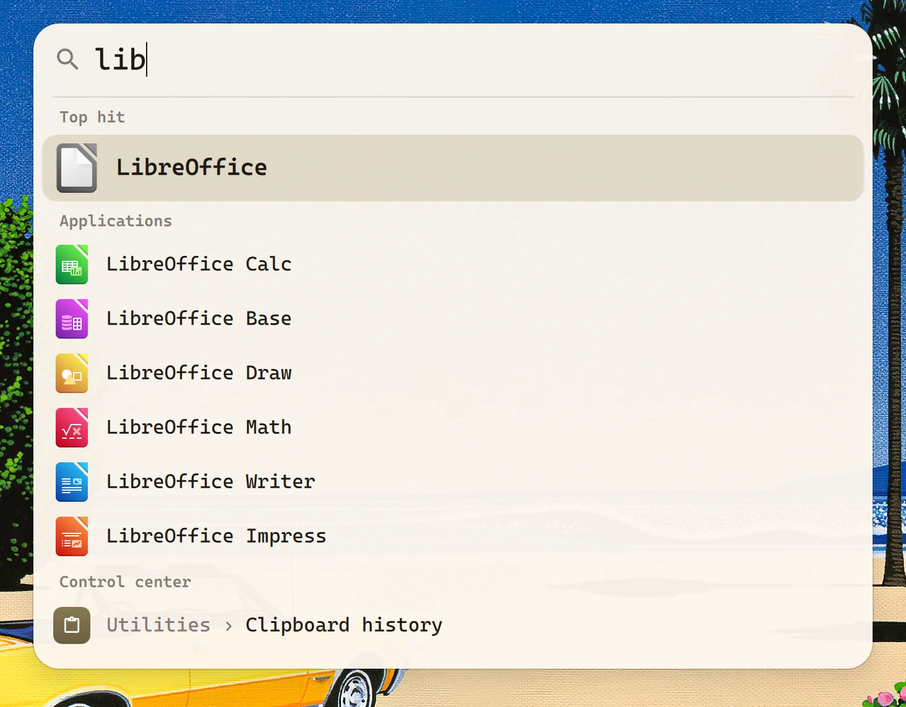
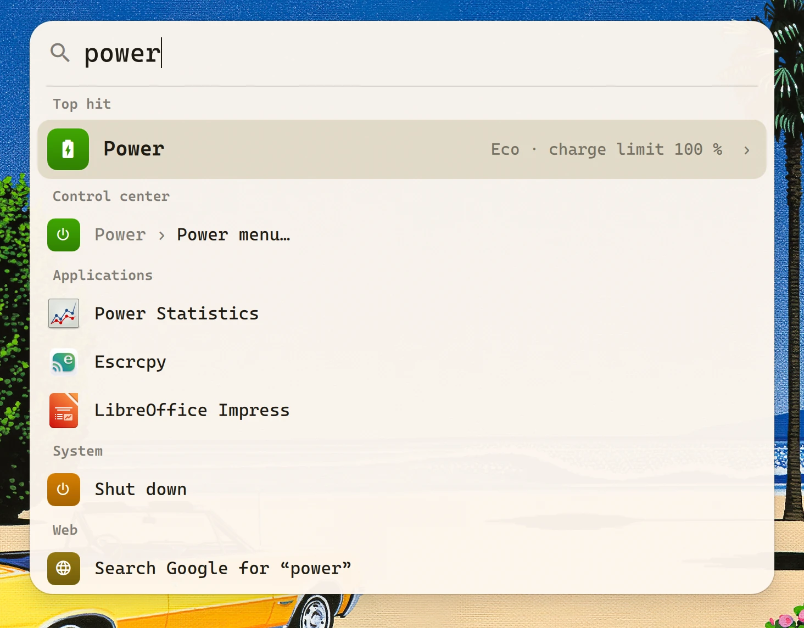
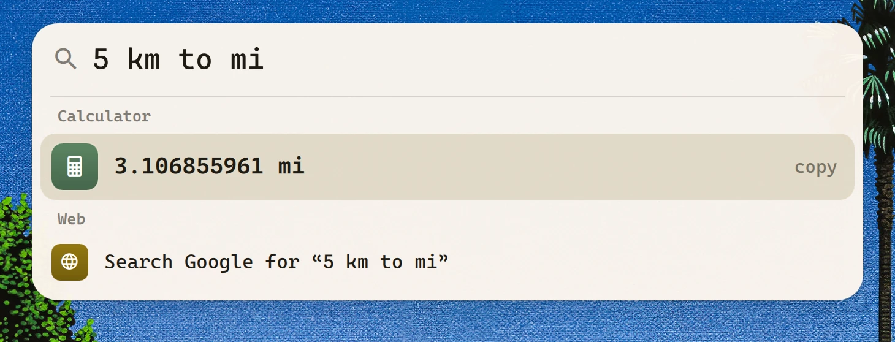
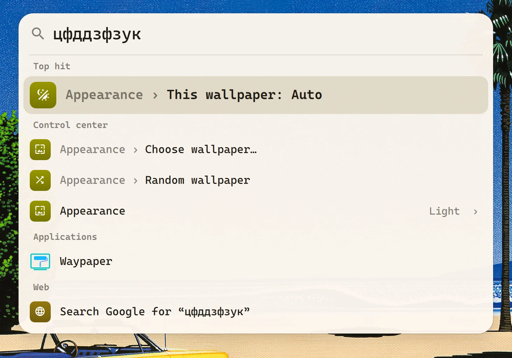
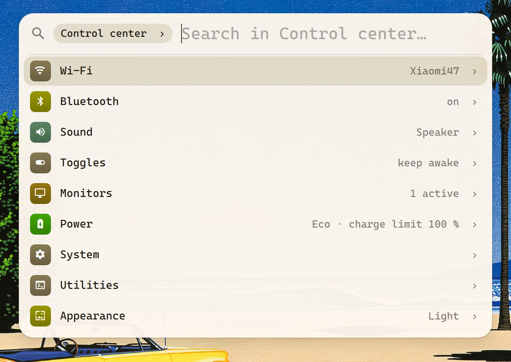

# quickseek

One search box for Hyprland, built on [Quickshell](https://quickshell.org): apps, files, your own
settings menus (as plugins), a calculator, power actions and web search, in a small animated window.

<p align="center"></p>

- Results grouped like a desktop spotlight: top hit, then Applications, plugin groups, Web.
- Files and folders in your home, from a private `plocate` index plus a live look at Downloads,
  Desktop and Documents.
- Learns what you pick (frecency) and which item you pick for a query. Ctrl+P pins anything to the top.
- Typed in the wrong keyboard layout? `цфддзфзук` finds the same as `wallpaper` (ЙЦУКЕН ↔ QWERTY).
- Calculator and unit conversion through `qalc`: `2^10`, `5 km to mi`, `=sqrt(2)`. Enter copies the result.
- Web: the last row is always "Search Google for …"; prefixes `g`, `yt`, `aw` (Arch Wiki).
- Plugins are plain executables speaking JSON Lines, see [docs/plugins.md](docs/plugins.md).
- Runs as a daemon with no timers or polling: idle means zero CPU and no wakeups. The window is
  created on open and destroyed after it closes.

## Screenshots

| | |
|:-:|:-:|
|  |  |
| Applications | Plugins next to apps and system actions |
|  |  |
| Calculator and unit conversion | Wrong keyboard layout |
|  | |
| A plugin opened as a folder (Tab) | |

## Requirements

Hyprland, Quickshell ≥ 0.3, a Nerd Font for glyph icons. Optional: `fd` and `plocate` (files),
`qalc` (libqalculate), `wl-copy`.

Icons come from the Qt icon theme. If file and folder icons show up as plain glyphs, Qt has no
theme: set `QT_QPA_PLATFORMTHEME` (e.g. `kde`, `gtk3`) or `QS_ICON_THEME=Adwaita` for the daemon.

## Run

```sh
git clone https://github.com/… ~/Apps/quickseek
qs -p ~/Apps/quickseek -n            # start the daemon (put it in your autostart)
```

Hyprland (Lua config):

```lua
hl.bind("SUPER + ALT + Space", hl.dsp.global("quickseek:toggle"))
```

or the classic config: `bind = SUPER ALT, Space, global, quickseek:toggle`.

IPC: `qs -p ~/Apps/quickseek ipc call quickseek toggle|open|close`, `… folder plugin:<id>`,
`… search <text>`.

Under uwsm, start the daemon with `uwsm app -s b -- qs -p ~/Apps/quickseek -n` and set
`"launchPrefix": ["uwsm", "app", "--"]`, so apps get their own scope instead of living in quickseek's.

## Keys

| key                           | action                                      |
|-------------------------------|---------------------------------------------|
| ↑ ↓, Ctrl+K Ctrl+J            | move                                        |
| Enter                         | run / open folder                           |
| Alt+Enter                     | show a file in its folder                   |
| Ctrl+P                        | pin / unpin                                 |
| Tab                           | open folder                                 |
| Backspace on an empty query   | leave the folder                            |
| Esc                           | close                                       |

Restart, Shut down and Log out ask for a second Enter.

## Files

`bin/quickseek-files` keeps a [plocate](https://plocate.sesse.net) index of `$HOME` in
`~/.cache/quickseek/` (about half a second of CPU for 75 000 files). It skips hidden paths, `.cache`,
Trash, Steam, `node_modules`, `.git` and whatever `~/.config/quickseek/ignore` lists (gitignore
syntax). A query that starts with a dot also searches hidden files up to three levels deep:
`.zshrc`, `.config`.

The index is rebuilt when the window opens and the index is older than two hours, and from
"quickseek settings › Rebuild file index". Downloads, Desktop and Documents are listed live on every
open, so new downloads show up right away. To keep the index fresh without opening the window, enable
the timer (every 30 min; on battery only when the index is older than 2 h):

```sh
# edit the path in systemd/quickseek-index.service if quickseek is not in ~/Apps/quickseek
systemctl --user link ~/Apps/quickseek/systemd/quickseek-index.{service,timer}
systemctl --user enable --now quickseek-index.timer
```

## Settings

`~/.config/quickseek/settings.json`, applied on save. Everything is optional, see
[examples/settings.json](examples/settings.json):

| key            | default                         |                                                     |
|----------------|---------------------------------|-----------------------------------------------------|
| `width`        | 680                             | logical px, shrinks on narrow monitors              |
| `maxRows`      | 9                               |                                                     |
| `opacity`      | 0.96                            | background opacity                                  |
| `fonts`        | desktop font, Symbols Nerd Font, 11 | `{ "text", "icons", "size" }`; empty `text` = gsettings `font-name`, else sans-serif |
| `shadow`       | true                            | drop shadow under the window                        |
| `colors`       |                                 | path to a colors file, see below                    |
| `launchPrefix` | `[]`                            | prepended to app launches and the opener            |
| `opener`       | `["gio", "open"]`               | opens files, folders and URLs; unlike `xdg-open`, gio starts terminal apps such as nvim in a terminal |
| `emptyView`    | `[]`                            | what an empty query shows: `"pinned"`, `"recent"`, `"popular"` |
| `files`        | `{ "enabled": true }`           | file search                                         |
| `plugins`      | `[]`                            | see [docs/plugins.md](docs/plugins.md)              |
| `web`          | Google, YouTube, Arch Wiki      | `{ "default": "g", "engines": { "g": { "name", "url": "…%s" } } }` |
| `power`        | systemctl / loginctl            | commands for `lock`, `suspend`, `reboot`, `shutdown`, `logout` |
| `include`      | `[]`                            | more JSON files merged on top (watched too)         |

Search for `quickseek settings` to change the empty screen and file search, rebuild the index,
unpin everything or clear the history from the window itself. That rewrites `settings.json`
(formatting is lost, the content is kept; symlinks are followed).

`include` lets other tools change settings without touching your file, e.g. a script that writes
`{ "opacity": 0.45, "shadow": false }` when a blur effect is on.

## Colors

The first file that exists wins:

1. `colors` from settings;
2. `~/.cache/quickseek/colors.json`: render [templates/wallust.json.j2](templates/wallust.json.j2)
   (wallust) or [templates/matugen.json](templates/matugen.json) (matugen) there;
3. `~/.cache/wal/colors.json` (pywal);
4. a built-in dark palette.

The format is pywal's (`special.background`, `special.foreground`, `colors.color0…15`) with an
optional `accent`, or flat `{ "background", "foreground", "accent" }`. Light or dark look follows the
background. Files are watched: a new wallpaper recolors an open window.

## License

MIT
